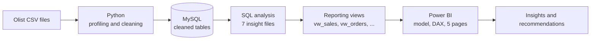
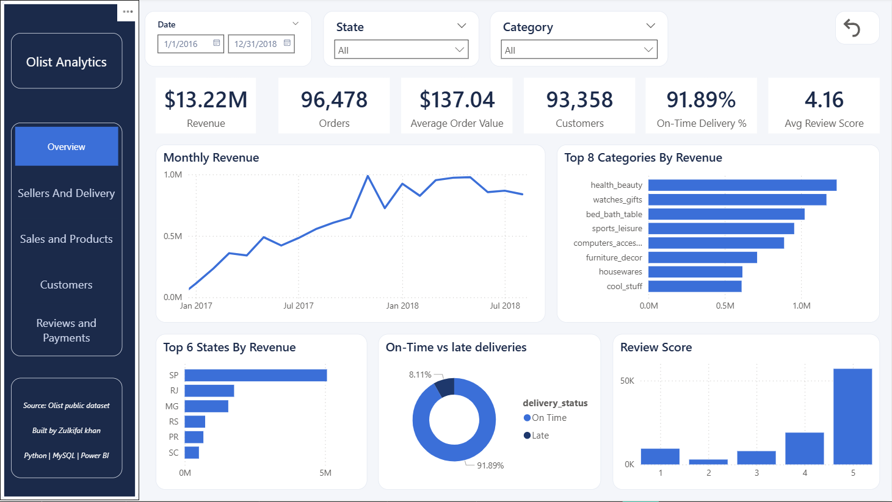
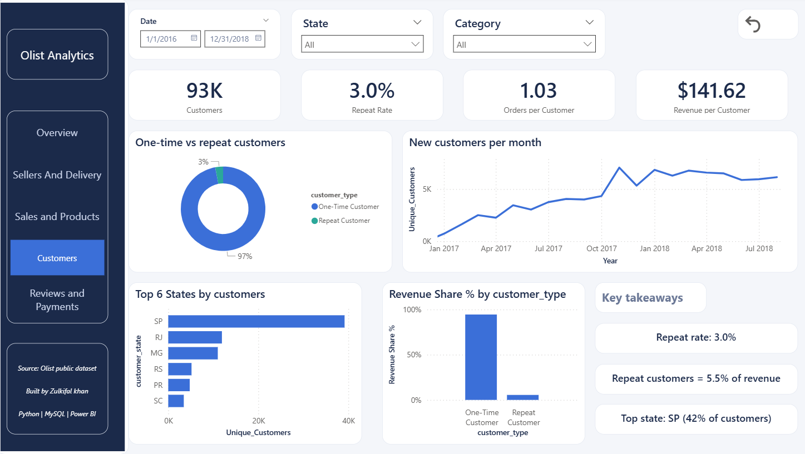

# Retail Data Analytics Warehouse | Olist Brazilian E-commerce


An end-to-end analytics pipeline built on the public Olist Brazilian e-commerce dataset: raw CSV files are profiled and cleaned in **Python**, loaded into **MySQL**, analysed with **SQL**, exposed through a **view layer**, and presented in a five-page **Power BI** dashboard that answers real business questions about sales, delivery, customers, reviews and payments.

[**Dashboard**](#dashboard) · [**Key insights**](#key-insights) · [**Architecture**](#architecture) · [**How to reproduce**](#how-to-reproduce) · [**Future work**](#future-work)

<a href="images/01_overview.png"></a>

*Click the image to open it full size. A PDF export of every page is in [`reports/olist_dashboard.pdf`](reports/olist_dashboard.pdf).*

---

## Table of contents

1. [Project overview](#project-overview)
2. [Key results](#key-results)
3. [Architecture](#architecture)
4. [Dataset](#dataset)
5. [Repository structure](#repository-structure)
6. [Pipeline walkthrough](#pipeline-walkthrough)
7. [Dashboard](#dashboard)
8. [Key insights](#key-insights)
9. [Data quality and validation](#data-quality-and-validation)
10. [Metric definitions](#metric-definitions)
11. [Limitations](#limitations)
12. [How to reproduce](#how-to-reproduce)
13. [Skills demonstrated](#skills-demonstrated)
14. [Future work](#future-work)
15. [About the author](#about-the-author)

---

## Project overview

An online marketplace needs to know what sells, where, how reliably orders arrive, who comes back, and what customers think. This project builds the full path from raw data to those answers:

- **Clean and understand the data** (profiling, type fixes, missing values, joins) in Python.
- **Store it in a relational warehouse** (MySQL) with a clear schema.
- **Analyse it with SQL** across seven business areas, with each area in its own file.
- **Publish a reporting layer** of SQL views, so the dashboard reads clean, consistent tables instead of raw data.
- **Build a Power BI dashboard** with a proper data model, reusable DAX measures, slicers, dynamic takeaways and a clickable page navigator.

**Business questions answered**

| Area | Question |
|---|---|
| Sales and products | What sells, at what price, and what does it cost to deliver? |
| Sellers and delivery | How reliable is delivery, and does lateness hurt customers? |
| Customers | Do customers come back, and does it matter for revenue? |
| Reviews and payments | How satisfied are customers, and how do they pay? |

---

## Key results

| Metric | Value |
|---|---|
| Revenue (delivered orders, item price only) | **$13.22M** |
| Orders | **96,478** |
| Items sold | **110,197** |
| Unique customers | **93,358** |
| Active sellers | **2,970** |
| Average order value | **$137.04** |
| On-time delivery | **91.89%** |
| Average delivery time | **12.5 days** |
| Average review score | **4.16 / 5** |

All figures come from delivered orders and were checked against SQL (see [Data quality and validation](#data-quality-and-validation)).

---

## Architecture



**Data model (Power BI).** One row-per-order "register" view (`vw_orders`) sits at the centre. Every other order-level table points back to it, so slicers for date and state filter the whole report and no relationship is many-to-many.

<a href="docs/data_model.png"></a>

| From | To | Type |
|---|---|---|
| `Date` | `vw_orders` | one to many |
| `vw_orders` | `vw_sales` | one to many |
| `vw_orders` | `vw_reviews` | one to many |
| `vw_orders` | `vw_payments` | one to many |
| `vw_orders` | `vw_delivery` | one to one |
| `vw_products` | `vw_sales` | one to many |
| `vw_sellers` | `vw_sales` | one to many |
| `vw_customers` | `vw_sales` | one to many |

---

## Dataset

- **Source:** the public [Brazilian E-Commerce Public Dataset by Olist](https://www.kaggle.com/datasets/olistbr/brazilian-ecommerce) on Kaggle. Check the licence on the Kaggle page before reusing the data.
- **Period:** orders from 2016 to 2018.
- **Contents:** customers, orders, order items, products, sellers, payments, reviews, geolocation and a category translation table (Portuguese to English).
- **Note:** the raw files are **not** included in this repository. Download them from Kaggle (see [How to reproduce](#how-to-reproduce)).

---

## Repository structure

```
retail_data_analytics_warehouse/
├── README.md
├── LICENSE
├── .env.example              # database settings template (no secrets)
├── data/
│   ├── raw/                  # Olist CSVs (download from Kaggle, not committed)
│   └── processed/            # cleaned files produced by Python
├── python/                   # profiling and transformation notebooks
├── database/                 # MySQL schema, load, analysis files, views, validation
├── powerbi/                  # dashboard (.pbix) and theme
├── docs/                     # data model, project plan, build log
├── images/                   # screenshot of every dashboard page
└── reports/                  # PDF export of the dashboard
```

| Quick links | |
|---|---|
| Project plan | [`docs/project_plan.md`](docs/project_plan.md) |
| Build log (how every step was done) | [`docs/build_log.md`](docs/build_log.md) |
| Reporting views | [`database/analytics_views.sql`](database/analytics_views.sql) |
| Validation queries | [`database/validation_checks.sql`](database/validation_checks.sql) |
| Dashboard file | [`powerbi/`](powerbi/) |
| PDF report | [`reports/olist_dashboard.pdf`](reports/olist_dashboard.pdf) |

---

## Pipeline walkthrough

<details>
<summary><b>1. Python: data profiling</b></summary>

- Inspected every table: shape, data types, missing values, duplicates, value ranges and key uniqueness.
- Documented problems before changing anything, so every cleaning step has a reason.
- Notebook: [`python/`](python/)
</details>

<details>
<summary><b>2. Python: data transformation</b></summary>

- Fixed data types (dates and numeric columns), handled missing values and standardised text fields.
- Wrote the cleaned tables to `data/processed/` and loaded them into MySQL with Python.
- Database credentials are read from environment variables (`.env`), never stored in code.
- Notebook: [`python/`](python/)
</details>

<details>
<summary><b>3. MySQL: warehouse and analysis (7 SQL files)</b></summary>

Each file answers questions for one business area:

| File | Area |
|---|---|
| `database/<customers file>.sql` | Customer behaviour, repeat buyers, geography |
| `database/<products file>.sql` | Product performance and pricing |
| `database/<category file>.sql` | Category revenue and freight |
| `database/<orders file>.sql` | Order volume, value and trends |
| `database/<sellers file>.sql` | Seller performance and concentration |
| `database/<delivery file>.sql` | Delivery time, lateness and delay |
| `database/<payments file>.sql` | Payment methods and instalments |

All files are in [`database/`](database/).
</details>

<details>
<summary><b>4. SQL: the reporting view layer</b></summary>

Dashboard-ready views, each with a defined grain (what one row means):

| View | One row is... | Used for |
|---|---|---|
| `vw_sales` | one item sold | revenue, products, categories, freight |
| `vw_orders` | one delivered order | date and state filtering, the model's hub |
| `vw_customers` | one customer | repeat vs one-time, customer type |
| `vw_products` | one product | product attributes |
| `vw_sellers` | one seller | seller location and totals |
| `vw_delivery` | one delivered order with a delivery date | on-time, delivery days, delay |
| `vw_reviews` | one review | review scores |
| `vw_payments` | one payment | payment methods and instalments |

Key fixes made in this layer: English category names (with a fallback for untranslated ones), a real date column for the Date table, `customer_unique_id` instead of `customer_id` for customer counts, and seller location. Definitions: [`database/analytics_views.sql`](database/analytics_views.sql)
</details>

<details>
<summary><b>5. Power BI: model, DAX and dashboard</b></summary>

- Star-style model around `vw_orders`, plus a dedicated `Date` table.
- All KPIs are DAX measures, so every number responds to the slicers.
- Dynamic "Key takeaways" boxes written with DAX, each with a fallback message for small selections.
- Custom theme, clickable page navigator, reset button per page and a consistent layout.
- Full step-by-step record: [`docs/build_log.md`](docs/build_log.md)
</details>

---

## Dashboard

Click any page to open the full-size screenshot.

<table>
  <tr>
    <td align="center"><a href="images/01_overview.png"></a><br><b>1. Overview</b></td>
    <td align="center"><a href="images/02_sales_products.png"></a><br><b>2. Sales &amp; Products</b></td>
    <td align="center"><a href="images/03_sellers_delivery.png"></a><br><b>3. Sellers &amp; Delivery</b></td>
  </tr>
  <tr>
    <td align="center"><a href="images/04_customers.png"></a><br><b>4. Customers</b></td>
    <td align="center"><a href="images/05_reviews_payments.png"></a><br><b>5. Reviews &amp; Payments</b></td>
    <td align="center"><a href="reports/olist_dashboard.pdf"><b>Full PDF report</b></a></td>
  </tr>
</table>

<details>
<summary><b>Page 1: Overview</b> (how is the business doing?)</summary>

<a href="images/Overview.png"></a>

- **Shows:** six KPI cards (revenue, orders, average order value, customers, on-time delivery, average review), monthly revenue trend, top categories, top states, on-time vs late split and the review score distribution.
- **Interaction:** date, state and category slicers, and a reset button.
- **Takeaway:** revenue grew steadily through 2017 and then levelled off in 2018.
</details>

<details>
<summary><b>Page 2: Sales &amp; Products</b> (what sells, and what does it cost to deliver?)</summary>

<a href="images/Sales & Products.png"></a>

- **Shows:** category performance table (revenue, items, average price, freight share), freight cost by state, and three dynamic takeaway sentences.
- **Design choice:** states with fewer than 100 orders are excluded from freight rankings, so a tiny sample cannot top the list.
- **Takeaway:** a small group of categories carries most of the revenue, and freight takes a much bigger share of the price in northern and north-eastern states.
</details>

<details>
<summary><b>Page 3: Sellers &amp; Delivery</b> (how well do we deliver, and does lateness hurt?)</summary>

<a href="images/Sellers & Delivery.png"></a>

- **Shows:** on-time rate, average delivery days, late orders and average days late, review score for on-time vs late orders, slowest states, delivery time distribution and revenue by seller state.
- **Takeaway:** late orders receive far lower reviews, and some states wait much longer than others.
</details>

<details>
<summary><b>Page 4: Customers</b> (do customers come back?)</summary>

<a href="images/Customers.png"></a>

- **Shows:** customers, repeat rate, orders per customer, revenue per customer, one-time vs repeat split, new customers per month, customers by state and the revenue share of each customer type.
- **Takeaway:** very few customers buy twice, so growth comes mostly from new customers.
</details>

<details>
<summary><b>Page 5: Reviews &amp; Payments</b> (how satisfied are customers, and how do they pay?)</summary>

<a href="images/Reviews & Payments.png"></a>

- **Shows:** average review score, share of low scores, total payment value, average instalments, review trend by month, lowest-rated states, payment method mix and credit card instalments.
- **Takeaway:** most value is paid by credit card, often in several instalments, and low reviews are not explained by late delivery alone.
</details>

---

## Key insights

Findings are observations from this dataset, not proof of cause. Recommendations are ideas to test.

1. **Revenue grew through 2017 and levelled off in 2018.** The business generated **$13.22M** from **96,478** delivered orders, at an average order value of **$137.04**.
2. **Revenue is concentrated.** The top 10 categories generate about **62%** of revenue <!-- verify: validation query 6 -->, with `health_beauty` the largest.
3. **Delivery is mostly reliable but has a costly tail.** **91.89%** of orders arrive on time (average **12.5 days**). The **7,826** late orders were late by about **8.9 days** on average.
4. **Late delivery is linked to much lower reviews.** Late orders average about **2.6** stars against about **4.3** for on-time orders <!-- verify: validation query 8 -->. Late orders are only about 8% of orders, yet about **12.8%** of reviews are 1 or 2 stars <!-- verify: validation query 15 -->, so lateness is not the only driver of low scores.
5. **Freight hits some regions hard.** Freight is about **16.6%** of revenue overall but reaches about **26%** in the highest state (Maranhao), with the top of the list made up of northern and north-eastern states <!-- verify: validation query 5 -->. Distance from sellers is a plausible explanation and a good next question to test, but it is not proven here.
6. **Customers rarely return.** Only about **3%** of customers placed more than one order, and they account for about **5.5%** of revenue <!-- verify: validation query 12 -->. New-customer acquisition drives growth.
7. **Payment habits favour credit cards and instalments.** Credit cards carry about **78%** of payment value and boleto about **18%** <!-- verify: validation query 18 -->. The average credit card order is paid in about **3.5** instalments <!-- verify: validation query 21 -->.
8. **The marketplace depends on a few sellers.** The top 10% of sellers generate roughly two thirds of revenue <!-- verify: validation query 11 -->, and São Paulo dominates both sellers and customers.

**Recommendations to test**

- Focus promotion on categories with high revenue and a low freight share.
- Investigate shipping cost and delivery time in the highest-freight states.
- Reduce late deliveries and track whether review scores improve.
- Test simple win-back offers for one-time customers, since repeat customers are worth more per head.

---

## Data quality and validation

- Every SQL view was checked with **control totals** (row counts, distinct orders, total revenue) after each change.
- Dashboard numbers were compared with SQL results.
- **Reconciliation:** total payment value (~$15.42M) is consistent with item revenue plus freight.
- Filters were tested with small selections (a single small state or category), which exposed and fixed edge cases: a ratio that divided by a filtered count, Top N filters that were not applied, and a blank chart caused by a minimum-sample rule.
- All design decisions and mistakes are recorded in [`docs/build_log.md`](docs/build_log.md).

---

## Metric definitions

| Metric | Definition |
|---|---|
| Revenue | Sum of item `price` for delivered orders (freight excluded) |
| Freight | Sum of `freight_value` |
| Payment value | What customers paid in total (item price plus freight, so higher than revenue) |
| Order | One distinct `order_id` (an order can have several items) |
| Customer | One distinct `customer_unique_id` (`customer_id` changes per order) |
| Average order value | Revenue / orders |
| On-time rate | Delivered orders that arrived on or before the estimated date / delivered orders with a delivery date |
| Repeat customer | A customer with more than one order across the whole dataset |
| Scope | Delivered orders only |

---

## Limitations

- Only **delivered** orders are included, so cancelled orders and the customers behind them are not analysed.
- The data covers **2016 to 2018**. Trend charts start in January 2017 because 2016 has very few orders.
- Seller and product names are **anonymised**, so analysis is by category, state and ID.
- Customer type (one-time or repeat) is based on the whole history, not on the selected date range.
- A review score is per review, not per order, and a few orders have more than one review.
- Relationships between delivery, freight and reviews are **associations**, not proven causes.
- Rankings that use averages exclude states or categories below a minimum sample size.

---

## How to reproduce

1. **Clone the repository**
   ```bash
   git clone https://github.com/<ZulkifalKhan889>/<Retails-Analytics-Data-Warehouse>.git
   cd <Retails-Analytics-Data-Warehouse>
   ```
2. **Get the data.** Download the Olist dataset from [Kaggle](https://www.kaggle.com/datasets/olistbr/brazilian-ecommerce) and place the CSV files in `data/raw/`.
3. **Set up Python**
   ```bash
   pip install -r python/requirements.txt
   ```
4. **Run the notebooks** in `python/` in order: profiling, then transformation and loading.
5. **Create the views.** Run the analysis files and then `database/analytics_views.sql` in MySQL.
6. **Check the numbers.** Run `database/validation_checks.sql` and compare with the dashboard.
7. **Open the dashboard.** Open the `.pbix` in `powerbi/` with Power BI Desktop. The file contains an imported snapshot of the data, so you can browse it without MySQL. To refresh it, point the data source to your own database.

---

## Skills demonstrated

| Area | What this project shows |
|---|---|
| Data cleaning | Profiling, type fixes, missing values, key checks in Python (pandas, NumPy) |
| SQL | Joins, aggregation, CTEs, views with clear grain, validation queries |
| Data modelling | Star-style model, fact and dimension thinking, one-to-many relationships, a Date table |
| Power BI and DAX | Measures, `CALCULATE`, `TOPN`, `REMOVEFILTERS`, dynamic text, slicers, bookmarks, navigation, themes |
| Analytics thinking | Business questions first, defined metrics, sensible sample-size rules, correlation vs causation |
| Data validation | Control totals, reconciliation, testing under filters |
| Engineering habits | Secrets kept out of code, Git workflow, documented decisions, reproducible steps |
| Communication | Dashboard design, plain-language insights, documentation |

---

## Future work

**Machine learning**
- [ ] Predict which orders will be delivered late (classification), using distance, seller and product features
- [ ] Predict which customers will make a second purchase (repeat-purchase model)
- [ ] Customer segmentation with RFM analysis or clustering
- [ ] Review sentiment analysis from the review text
- [ ] Revenue forecasting with time-series models

**Automation and engineering**
- [ ] Automate the pipeline end to end (scheduled script or Airflow) so cleaning, loading and view creation run in one step
- [ ] Add data quality tests (for example with Great Expectations or dbt tests) and run them on every load
- [ ] Add a GitHub Actions workflow that runs linting and the validation checks
- [ ] Containerise the pipeline with Docker
- [ ] Move the warehouse to a cloud database

**Dashboard and sharing**
- [ ] Publish the report to the Power BI Service and share a public link
- [ ] Add year-over-year comparison and trend indicators on the KPI cards
- [ ] Add a map of customers and delivery time by state
- [ ] Build a Streamlit version of the key insights for a live, browser-based demo

---

## About the author

**Zulkifal Khan**, Data Science, working towards data science and AI engineering roles.

- GitHub: [Zulkifalkhan889](https://github.com/ZulkifalKhan889)
- LinkedIn: [Zulkifal khan](https://www.linkedin.com/in/zulkifal-khan-a4b1a5351/?isSelfProfile=true)
- Email: zulkifalkhan126@gmail.com

**Acknowledgements.** Data: Olist, via Kaggle. Code in this repository is released under the MIT licence (see `LICENSE`). The dataset keeps its own licence.
